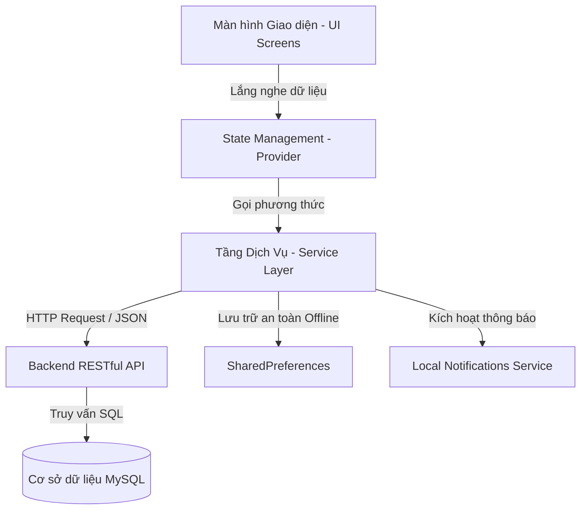

# Ứng Dụng Đặt Phòng Khách Sạn Luxury (Mobile App)
> **Đồ Án Môn Học:** Lập trình ứng dụng di động & Hệ thống thông tin khách sạn  
> **Nền tảng:** Flutter (Dart) kết nối Backend RESTful API & Cơ sở dữ liệu MySQL  
> **Phong cách thiết kế:** Gold & Dark Luxury Design System (Chuẩn 5 sao)

---

## 📑 MỤC LỤC
1. [Tổng Quan Kiến Trúc](#1-tổng-quan-kiến-trúc)
2. [Bảng Ma Trận Công Nghệ & Thư Viện](#2-bảng-ma-trận-công-nghệ--thư-viện)
3. [Thuyết Minh Chi Tiết Từng Tính Năng & Logic Nghiệp Vụ](#3-thuyết-minh-chi-tiết-từng-tính-năng--logic-nghiệp-vụ)
   - [3.1. Xác Thực Người Dùng & Quản Lý Phiên (JWT Token)](#31-xác-thực-người-dùng--quản-lý-phiên-jwt-token)
   - [3.2. Bảo Mật Ứng Dụng Bằng Mã PIN (Security Lock)](#32-bảo-mật-ứng-dụng-bằng-mã-pin-security-lock)
   - [3.3. Khám Phá, Tìm Kiếm & Lọc Phòng Thời Gian Thực](#33-khám-phá-tìm-kiếm--lọc-phòng-thời-gian-thực)
   - [3.4. Chi Tiết Hạng Phòng & Tối Ưu Tải Ảnh (Image Caching)](#34-chi-tiết-hạng-phòng--tối-ưu-tải-ảnh-image-caching)
   - [3.5. Quy Trình Đặt Phòng & Chu Trình CRUD Hoàn Chỉnh](#35-quy-trình-đặt-phòng--chu-trình-crud-hoàn-chỉnh)
   - [3.6. Hệ Thống Thông Báo Đẩy Cục Bộ (Local Notifications)](#36-hệ-thống-thông-báo-đẩy-cục-bộ-local-notifications)
   - [3.7. Trợ Lý Ảo AI Tư Vấn Thông Minh (On-Device NLP Engine)](#37-trợ-lý-ảo-ai-tư-vấn-thông-minh-on-device-nlp-engine)
   - [3.8. Quản Lý Trạng Thái Tập Trung (State Management - Provider)](#38-quản-lý-trạng-thái-tập-trung-state-management---provider)
4. [Cấu Trúc Thư Mục Mã Nguồn Chuẩn Hóa](#4-cấu-trúc-thư-mục-mã-nguồn-chuẩn-hóa)
5. [Cấu Hình Kết Nối API & Đa Môi Trường](#5-cấu-hình-kết-nối-api--đa-môi-trường)
6. [BỘ CÂU HỎI & ĐÁP ÁN BẢO VỆ VẤN ĐÁP VỚI GIẢNG VIÊN](#6-bộ-câu-hỏi--đáp-án-bảo-vệ-vấn-đáp-với-giảng-viên)

---

## 1. Tổng Quan Kiến Trúc

Ứng dụng được xây dựng theo mô hình **Layered Architecture (Kiến trúc phân tầng)** tách biệt rõ ràng giữa Giao diện (Presentation), Quản lý trạng thái (State Management), Nghiệp vụ kết nối mạng (Service/Repository) và Dữ liệu (Models):



---

## 2. Bảng Ma Trận Công Nghệ & Thư Viện

| Tên Package | Phiên Bản | Mục Đích Sử Dụng | Lý Do Chọn / Ưu Điểm Kỹ Thuật |
| :--- | :---: | :--- | :--- |
| **`provider`** | `^6.1.5+1` | Quản lý trạng thái (State Management) | Chuẩn khuyến nghị chính thức của Google Flutter Team, nhẹ hơn Bloc, dễ mở rộng, kiểm soát vòng đời tái render chính xác. |
| **`http`** | `^1.6.0` | Giao tiếp mạng với Backend API | Thư viện chính thống, hỗ trợ cấu hình Header, Bearer Token, kiểm soát mã HTTP Status Code và xử lý Exception. |
| **`shared_preferences`** | `^2.5.6` | Lưu trữ cấu hình & Token cục bộ trên thiết bị | Lưu Token đăng nhập, cấu hình khóa mã PIN và thông tin phiên làm việc xuống Key-Value Store an toàn của Android/iOS. |
| **`flutter_local_notifications`** | `^22.3.3` | Bắn thông báo đẩy tức thì (Push Notifications) | Hoạt động offline độc lập không phụ thuộc Firebase Cloud Messaging, hỗ trợ tạo Channel, rung và chuông trên Android 13+. |
| **`cached_network_image`** | `^4.0.4` | Tải & lưu đệm hình ảnh phòng khách sạn | Tự động cache ảnh vào bộ nhớ máy, hiển thị shimmer/loading khi đang tải, hạn chế gọi lại băng thông mạng nhiều lần. |
| **`intl`** | `^0.20.3` | Chuẩn hóa định dạng tiền tệ và thời gian | Định dạng tiền tệ Việt Nam Đồng (`1.200.000 ₫`) và chuẩn hóa ngày giờ check-in / check-out theo văn hóa bản địa. |
| **`google_fonts`** | `^6.2.1` | Kiểu chữ nghệ thuật Montserrat sang trọng | Đảm bảo tính thẩm mỹ đồng bộ xuyên suốt các nền tảng thiết bị di động mà không cần bundle thủ công file font tốn dung lượng. |
| **`cupertino_icons`** | `^1.0.8` | Biểu tượng icon phong cách iOS/Apple | Bổ sung biểu tượng tinh tế kết hợp hoàn hảo cùng Material Icons. |

---

## 3. Thuyết Minh Chi Tiết Từng Tính Năng & Logic Nghiệp Vụ

### 3.1. Xác Thực Người Dùng & Quản Lý Phiên (JWT Token)
* **Thư viện sử dụng:** `http`, `shared_preferences`, `provider`.
* **Mã nguồn liên quan:** 
  - `lib/dich_vu/xac_thuc_dich_vu.dart`
  - `lib/quan_ly_trang_thai/xac_thuc_provider.dart`
  - `lib/man_hinh/xac_thuc/man_hinh_dang_nhap.dart`
  - `lib/man_hinh/xac_thuc/man_hinh_dang_ky.dart`
* **Logic xử lý chi tiết:**
  1. **Đăng nhập (`dangNhap`):** Gửi `so_dien_thoai` hoặc `email` và `mat_khau` lên endpoint `/api/dang-nhap`.
  2. Khi Backend trả về mã HTTP `200` cùng chuỗi `token` (JWT) và thông tin `user`:
     - Token được ghi vào bộ nhớ máy qua `SharedPreferences.setString('token_nguoi_dung', token)`.
     - Cập nhật biến `_nguoiDung` trong `XacThucProvider` và gọi `notifyListeners()` để toàn bộ giao diện tự động cập nhật sang trạng thái Đã Đăng Nhập.
  3. **Tự động khôi phục phiên (`khoiTao`):** Mỗi khi mở ứng dụng (`main.dart`), phương thức `khoiTao()` sẽ đọc token từ `SharedPreferences`. Nếu token tồn tại, hệ thống âm thầm gọi `/api/thong-tin-nguoi-dung` để xác thực tính hợp lệ của token và tải thông tin mới nhất.
  4. **Đăng xuất (`dangXuat`):** Xóa trắng token trong `SharedPreferences` và đặt trạng thái người dùng về `null`.

---

### 3.2. Bảo Mật Ứng Dụng Bằng Mã PIN (Security Lock)
* **Thư viện sử dụng:** `shared_preferences`.
* **Mã nguồn liên quan:**
  - `lib/dich_vu/bao_mat_dich_vu.dart`
  - `lib/man_hinh/xac_thuc/man_hinh_khoa_pin.dart`
  - Tích hợp tại: `lib/man_hinh/dieu_huong_chinh.dart`, `lib/man_hinh/tai_khoan/man_hinh_tai_khoan.dart`
* **Logic xử lý chi tiết:**
  1. **Thiết lập mã PIN:** Người dùng có thể cài đặt mã PIN bảo vệ (4 chữ số). Dữ liệu được lưu trữ nội bộ an toàn trong `SharedPreferences` với key `app_security_pin`.
  2. **Kiểm tra khi khởi động hoặc truy cập vùng nhạy cảm:**
     - Khi người dùng bật cờ `isPinLockEnabled`, mỗi khi mở ứng dụng hoặc truy cập vào tab **Tài Khoản / Lịch Sử Giao Dịch**, ứng dụng hiển thị màn hình khóa mã PIN phong cách Luxury (`ManHinhKhoaPin`).
     - Bàn phím số cảm ứng tích hợp hiệu ứng phản hồi, kiểm tra khớp mã:
       + Nếu đúng mã: Cho phép mở khóa và điều hướng vào màn hình đích.
       + Nếu sai mã: Hiệu ứng rung chấm tròn đỏ báo lỗi, xóa trường nhập và yêu cầu nhập lại.

---

### 3.3. Khám Phá, Tìm Kiếm & Lọc Phòng Thời Gian Thực
* **Thư viện sử dụng:** `http`, `intl`, `provider`.
* **Mã nguồn liên quan:**
  - `lib/dich_vu/phong_dich_vu.dart`
  - `lib/man_hinh/trang_chu/thanh_phan/khung_tim_kiem_nhanh.dart`
  - `lib/man_hinh/tim_kiem/man_hinh_tim_kiem.dart`
  - `lib/tien_ich/xu_ly_ngay.dart`
* **Logic xử lý chi tiết:**
  1. Người dùng chọn ngày nhận (`ngay_nhan`), ngày trả (`ngay_tra`) và số lượng khách (`so_khach`).
  2. Hàm `XuLyNgay.tinhSoDem()` tự động tính toán tổng số đêm lưu trú.
  3. Gửi query param lên backend: `GET /api/phong?ngay_nhan=...&ngay_tra=...&so_nguoi=...`.
  4. Backend kiểm tra loại trừ các phòng đã được đặt và cọc trong khoảng thời gian trùng lặp.
  5. Ứng dụng nhận danh sách `List<LoaiPhong>` thỏa mãn điều kiện và render lên danh sách tìm kiếm kèm bộ lọc phân loại (Tất cả, Cao cấp, Tiết kiệm, Hướng biển).

---

### 3.4. Chi Tiết Hạng Phòng & Tối Ưu Tải Ảnh (Image Caching)
* **Thư viện sử dụng:** `cached_network_image`.
* **Mã nguồn liên quan:**
  - `lib/man_hinh/chi_tiet_phong/man_hinh_chi_tiet_phong.dart`
  - `lib/cau_hinh/cau_hinh_api.dart` (Hàm `CauHinhApi.layUrlHinhAnh(...)`)
* **Logic xử lý chi tiết:**
  1. Hạng phòng trong CSDL có thể lưu đường dẫn tương đối (ví dụ `storage/phong/suite.jpg`). Hệ thống chuẩn hóa đường dẫn đầy đủ qua `CauHinhApi.layUrlHinhAnh(path)`.
  2. `CachedNetworkImage` kiểm tra bộ đệm trên ổ đĩa của thiết bị:
     - Nếu ảnh đã tải trước đó: Đọc trực tiếp từ Disk Cache (hiển thị tức thì 0 giây, không tốn data).
     - Nếu chưa có: Tải từ Server, hiển thị hiệu ứng xoay tải nhẹ nhàng (`CircularProgressIndicator`) và tự động lưu vào cache.
     - Nếu mất mạng hoặc link lỗi: Tự động hiển thị giao diện ảnh mặc định kèm icon khách sạn sang trọng (`errorWidget`).

---

### 3.5. Quy Trình Đặt Phòng & Chu Trình CRUD Hoàn Chỉnh
* **Thư viện sử dụng:** `http`, `provider`, `flutter_local_notifications`.
* **Mã nguồn liên quan:**
  - `lib/dich_vu/dat_phong_dich_vu.dart`
  - `lib/quan_ly_trang_thai/dat_phong_provider.dart`
  - `lib/man_hinh/dat_phong/man_hinh_dat_phong.dart`
  - `lib/man_hinh/tai_khoan/man_hinh_chi_tiet_dat_phong.dart`
* **Chu trình CRUD 4 thao tác chuẩn:**
  1. **Create (Tạo đơn):** Người dùng nhập thông tin -> `DatPhongDichVu.taoDonDatPhong()` gửi `POST /api/dat-phong`. Server tạo mã đơn, tính tổng tiền. App kích hoạt thông báo cục bộ và chuyển đến màn hình thành công.
  2. **Read (Xem danh sách & chi tiết):** 
     - Lấy lịch sử: `GET /api/dat-phong/lich-su` -> Hiển thị danh sách thẻ đơn đặt phòng.
     - Xem chi tiết: Bấm vào đơn để xem trạng thái phòng, số đêm, tiền cọc, danh sách dịch vụ đi kèm.
  3. **Update (Đặt thêm dịch vụ gia tăng):** Trong chi tiết đơn, khách bấm chọn thêm dịch vụ (Spa, Ăn sáng, Đưa đón) -> `POST /api/dat-phong/{id}/dat-dich-vu` -> Cập nhật tổng tiền đơn và trạng thái phục vụ.
  4. **Delete / Cancel (Hủy đơn đặt phòng):** Khách sạn hỗ trợ hủy phòng trực tiếp trên app:
     - Bấm nút **"Hủy Đơn Đặt Phòng Này"** kèm hộp thoại cảnh báo xác nhận.
     - Gọi `PUT /api/dat-phong/{id}/huy` -> Backend đổi trạng thái sang `da_huy` và giải phóng phòng trong CSDL.
     - Bắn thông báo cục bộ xác nhận hủy đơn thành công lên điện thoại.

---

### 3.6. Hệ Thống Thông Báo Đẩy Cục Bộ (Local Notifications)
* **Thư viện sử dụng:** `flutter_local_notifications: ^22.3.3`.
* **Mã nguồn liên quan:**
  - `lib/dich_vu/thong_bao_dich_vu.dart`
  - Cấu hình Android: `android/app/build.gradle.kts` (Bật Core Library Desugaring) và `AndroidManifest.xml` (`POST_NOTIFICATIONS`, `VIBRATE`).
* **Logic xử lý chi tiết:**
  1. **Khởi tạo (`ThongBaoDichVu.khoiTao`):** Được gọi ngay trong hàm `main()` trước khi app render.
  2. Tạo kênh thông báo chuẩn Android (`AndroidNotificationChannel`):
     - Channel ID: `luxury_hotel_notifications`
     - Channel Name: `Thông báo Khách Sạn Luxury`
     - Tầm quan trọng: `Importance.max`, ưu tiên hiển thị đầu màn hình (`Priority.high`).
  3. **Kích hoạt sự kiện nghiệp vụ thực tế:**
     - Khi đặt phòng thành công: `ThongBaoDichVu.thongBaoDatPhongThanhCong(...)` phát thông báo kèm mã đơn.
     - Khi hủy đơn đặt phòng: `ThongBaoDichVu.thongBaoHuyDonThanhCong(...)` phát thông báo cập nhật hủy phòng.
     - Khi gọi thêm dịch vụ: `ThongBaoDichVu.thongBaoDatDichVu(...)` phát thông báo xác nhận món/dịch vụ.

---

### 3.7. Trợ Lý Ảo AI Tư Vấn Thông Minh (On-Device NLP Engine)
* **Công nghệ:** Thuật toán mã nguồn nội bộ Dart (Chạy trực tiếp trên máy - On-Device NLP), không phụ thuộc vào Internet hay API bên ngoài có phí.
* **Mã nguồn liên quan:**
  - `lib/dich_vu/tro_ly_ai_engine.dart`
  - `lib/dich_vu/bot_ai_dich_vu.dart`
  - `lib/man_hinh/tro_ly_ai/man_hinh_tro_ly_ai.dart`
* **Quy trình 5 bước xử lý ngôn ngữ tự nhiên:**
  1. **Tiền xử lý văn bản (Text Normalization):** Chuyển chữ thường, chuẩn hóa dấu tiếng Việt, loại bỏ ký tự rác.
  2. **Trích xuất thực thể (Named Entity Recognition - NER):** Dùng Regex & từ khóa nhận diện:
     - Số lượng khách (ví dụ: *"cho 4 người"*, *"đi 2 người lớn"*).
     - Sở thích không gian (*"view biển"*, *"hướng biển"*, *"ban công"*).
     - Phân khúc ngân sách (*"cao cấp"*, *"sang xịn"*, *"rẻ"*, *"tiết kiệm"*).
  3. **Nhận diện ý định (Intent Classification):** Phân loại câu hỏi thành các nhóm: Tư vấn phòng, Hỏi chính sách nhận/trả phòng, Hỏi quy định đặt cọc, Hỏi dịch vụ khách sạn.
  4. **Thuật toán chấm điểm phòng (Weighted Scoring Algorithm):** Duyệt qua danh sách phòng thực tế từ CSDL và tính điểm theo trọng số:
     - Khớp sức chứa số người: `+40 điểm`.
     - Khớp view/tiện ích yêu cầu: `+30 điểm`.
     - Khớp tầm giá ngân sách: `+30 điểm`.
  5. **Sinh câu trả lời & Carousel Card:** Trả về câu tư vấn lịch thiệp cùng danh sách thẻ phòng có điểm số cao nhất cho phép người dùng bấm **Xem Chi Tiết** hoặc **Đặt Ngay**.
  * 📄 *Xem chi tiết thuyết minh chuyên sâu dành cho Giảng viên tại:* [README_AI.md](./README_AI.md)

---

### 3.8. Quản Lý Trạng Thái Tập Trung (State Management - Provider)
* **Thư viện sử dụng:** `provider: ^6.1.5+1`.
* **Mã nguồn liên quan:**
  - `lib/quan_ly_trang_thai/xac_thuc_provider.dart`
  - `lib/quan_ly_trang_thai/dat_phong_provider.dart`
* **Logic hoạt động:**
  - Kế thừa lớp `ChangeNotifier` của Flutter.
  - Khi có sự kiện thay đổi dữ liệu (ví dụ chọn ngày nhận phòng, đăng nhập thành công), hàm nghiệp vụ thực hiện gán giá trị và gọi `notifyListeners()`.
  - Các Widget con bọc trong `Consumer<T>` hoặc `context.watch<T>()` sẽ tự động kích hoạt hàm `build()` vẽ lại giao diện tức thời mà không cần truyền biến trung gian qua hàng chục cấp widget.

---

## 4. Cấu Trúc Thư Mục Mã Nguồn Chuẩn Hóa

```text
lib/
├── main.dart                          # Khởi tạo App, cấu hình Provider và Notifications
├── cau_hinh/
│   ├── cau_hinh_api.dart              # URL Server API Online & Helper sinh URL ảnh
│   └── mau_sac_app.dart               # Theme màu Luxury (Vàng Kim, Đen Navy, Trắng Kem)
├── dich_vu/
│   ├── api_dich_vu.dart               # HTTP Base Client xử lý Header & Bearer Token
│   ├── bao_mat_dich_vu.dart           # Dịch vụ quản lý mã PIN & khóa ứng dụng
│   ├── thong_bao_dich_vu.dart         # Dịch vụ thông báo cục bộ Local Notifications
│   ├── xac_thuc_dich_vu.dart          # API Đăng nhập, đăng ký, thông tin tài khoản
│   ├── phong_dich_vu.dart             # API Danh sách phòng, chi tiết & tìm kiếm
│   ├── dat_phong_dich_vu.dart         # API CRUD Đơn đặt phòng (Đặt, Xem, Hủy, Dịch vụ)
│   ├── bot_ai_dich_vu.dart            # Cầu nối gửi nhận câu hỏi trợ lý AI
│   └── tro_ly_ai_engine.dart          # Động cơ NLP AI On-Device phân tích & chấm điểm phòng
├── mo_hinh/
│   ├── loai_phong.dart                # Model Phòng & Tiện nghi
│   ├── dat_phong.dart                 # Model Đơn đặt phòng & trạng thái
│   ├── nguoi_dung.dart                # Model Tài khoản người dùng
│   └── tin_nhan_bot.dart              # Model Tin nhắn Chatbot & Thẻ phòng đính kèm
├── quan_ly_trang_thai/
│   ├── xac_thuc_provider.dart         # Provider quản lý phiên User & Token
│   └── dat_phong_provider.dart        # Provider quản lý ngày giờ đặt phòng & số khách
├── man_hinh/
│   ├── dieu_huong_chinh.dart          # Thanh điều hướng 4 Tab chính (Bottom Navigation)
│   ├── trang_chu/                     # Tab Trang chủ (Banner, Tìm nhanh, Phòng nổi bật)
│   ├── tim_kiem/                      # Tab Tìm kiếm & Lọc phòng trống
│   ├── chi_tiet_phong/                # Chi tiết hạng phòng, ảnh cache, tiện ích
│   ├── dat_phong/                     # Form đặt phòng, hóa đơn dự kiến & xác nhận
│   ├── tro_ly_ai/                     # Tab Trợ lý ảo tư vấn & tương tác thông minh
│   ├── tai_khoan/                     # Thông tin cá nhân, Lịch sử đơn, Hủy đơn
│   └── xac_thuc/                      # Đăng nhập, Đăng ký, Khóa mã PIN
└── tien_ich/
    ├── dinh_dang.dart                 # Format tiền tệ VNĐ (₫), định dạng thời gian
    └── xu_ly_ngay.dart                # Tính toán khoảng cách số đêm lưu trú
```

---

## 5. Cấu Hình Kết Nối API & Đa Môi Trường

Tất cả cấu hình mạng được tập trung duy nhất tại:
👉 `lib/cau_hinh/cau_hinh_api.dart`

```dart
class CauHinhApi {
  // Môi trường Online Server Production:
  static String get duongDanGocMacDinh => 'https://vovandat.id.vn/KhachSan';
  
  // Khi chuyển sang chạy máy tính nội bộ (Localhost):
  // Android Emulator: http://10.0.2.2:8000
  // Thiết bị thật qua WiFi: http://192.168.1.x:8000
}
```

---

## 6. BỘ CÂU HỎI & ĐÁP ÁN BẢO VỆ VẤN ĐÁP VỚI GIẢNG VIÊN

Dưới đây là tập hợp các câu hỏi kinh điển Giảng viên thường đặt ra khi chấm đồ án Mobile và câu trả lời chuẩn xác nhất:

### ❓ Câu 1: Em quản lý trạng thái (State Management) trong ứng dụng bằng phương pháp nào? Tại sao lại chọn giải pháp đó?
* **Trả lời:**  
  *"Dạ thưa Thầy/Cô, em sử dụng thư viện **Provider** kết hợp cùng `ChangeNotifier`. Em chọn Provider vì đây là giải pháp được chính Google Flutter Team khuyến nghị chính thức. Nó giúp tách bạch hoàn toàn tầng giao diện (UI) và tầng logic nghiệp vụ, giải quyết triệt để vấn đề truyền dữ liệu qua nhiều tầng Widget (Prop Drilling). So với Bloc, Provider nhẹ hơn, dễ bảo trì và hoàn toàn đáp ứng tối ưu hiệu năng cho quy mô ứng dụng đặt phòng khách sạn."*

### ❓ Câu 2: Cơ chế đăng nhập và xác thực của ứng dụng hoạt động như thế nào? Nếu người dùng tắt ứng dụng mở lại có bị mất đăng nhập không?
* **Trả lời:**  
  *"Dạ thưa Thầy/Cô, ứng dụng áp dụng chuẩn **JSON Web Token (JWT)**:  
  1. Khi người dùng đăng nhập thành công, Server trả về một chuỗi `token`.  
  2. Em sử dụng thư viện `shared_preferences` để lưu token này xuống bộ nhớ an toàn của điện thoại.  
  3. Mọi request sau đó (như đặt phòng, xem lịch sử) đều được tự động gắn vào Header: `Authorization: Bearer <token>`.  
  4. Khi tắt ứng dụng và mở lại, hàm `khoiTao()` trong `main.dart` sẽ tự động đọc token cũ từ `SharedPreferences`, gửi lên Server xác thực lại. Nếu token còn hạn thì tự động duy trì đăng nhập mà không bắt người dùng nhập lại tài khoản."*

### ❓ Câu 3: Tính năng Hủy đơn đặt phòng hoạt động như thế nào? Nó có đảm bảo toàn vẹn dữ liệu trong CSDL không?
* **Trả lời:**  
  *"Dạ thưa Thầy/Cô, trong màn hình chi tiết đơn đặt phòng, em thiết kế nút **Hủy Đơn Đặt Phòng**:  
  - Ứng dụng sẽ hiển thị hộp thoại xác nhận để tránh người dùng bấm nhầm.  
  - Khi xác nhận, app gọi API `PUT /api/dat-phong/{id}/huy`. Backend sẽ kiểm tra trạng thái đơn, cập nhật trạng thái sang `da_huy` và giải phóng ngày phòng tương ứng trong CSDL.  
  - Sau khi Server phản hồi thành công, giao diện tự động cập nhật trạng thái đơn thành màu đỏ (Đã hủy), đồng thời kích hoạt `ThongBaoDichVu` bắn một thông báo đẩy xuống máy để người dùng an tâm."*

### ❓ Câu 4: Ứng dụng của em có tính năng bảo mật gì đặc biệt trên thiết bị không?
* **Trả lời:**  
  *"Dạ thưa Thầy/Cô, ứng dụng được trang bị tính năng **Khóa mã PIN an toàn (`ManHinhKhoaPin`)**:  
  - Người dùng có thể tự cài đặt mã PIN bảo vệ 4 số trong mục Tài khoản.  
  - Khi tính năng được kích hoạt, bất cứ khi nào mở app hoặc truy cập vào khu vực nhạy cảm (như thông tin cá nhân hay lịch sử giao dịch), ứng dụng sẽ khóa lại và yêu cầu nhập đúng mã PIN.  
  - Giao diện bàn phím số được xây dựng tùy biến cao cấp, có hiệu ứng phản hồi và chống nhìn trộm."*

### ❓ Câu 5: Hệ thống thông báo đẩy (Notification) hoạt động ra sao? Tại sao vừa rồi phải cấu hình Core Library Desugaring trong Gradle?
* **Trả lời:**  
  *"Dạ thưa Thầy/Cô:  
  - Em dùng thư viện `flutter_local_notifications` để phát thông báo thời gian thực ngay trên thiết bị khi có các sự kiện: Đặt phòng thành công, Hủy đơn phòng, hoặc Gọi thêm dịch vụ.  
  - Về Desugaring: Thư viện này sử dụng các hàm xử lý thời gian mới của Java 8+ (`java.time`). Để ứng dụng có thể chạy tương thích mượt mà trên tất cả các đời máy Android cũ lẫn mới, Android Gradle Plugin bắt buộc phải bật tính năng **Core Library Desugaring** (`desugar_jdk_libs`) trong file `build.gradle.kts` để trình biên dịch chuyển đổi các hàm Java mới về dạng tương thích với hệ điều hành của máy ảo/máy thật."*

### ❓ Câu 6: Tính năng Trợ Lý AI của em có phải là gọi API của OpenAI hay Gemini không? Nó hoạt động ra sao nếu mất mạng?
* **Trả lời:**  
  *"Dạ thưa Thầy/Cô, Trợ lý AI trong ứng dụng được em lập trình theo mô hình **On-Device NLP Engine (Xử lý trực tiếp trên thiết bị bằng thuật toán Dart)**:  
  - AI không phụ thuộc vào API OpenAI/Gemini bên ngoài (không mất phí duy trì, không bị nghẽn mạng).  
  - Động cơ AI gồm 5 bước: Chuẩn hóa câu hỏi tiếng Việt -> Bóc tách thực thể số người, tiện ích, view biển -> Nhận diện ý định -> Thuật toán chấm điểm phòng có trọng số dựa trên dữ liệu phòng thực tế -> Đề xuất danh sách thẻ phòng phù hợp nhất.  
  - Nhờ vậy, ngay cả khi API gặp sự cố, AI vẫn có khả năng phản hồi và hướng dẫn khách hàng bình thường."*

### ❓ Câu 7: Ứng dụng tối ưu hóa trải nghiệm tải hình ảnh như thế nào để không bị giật lag?
* **Trả lời:**  
  *"Dạ thưa Thầy/Cô, em sử dụng thư viện `cached_network_image`. Khi người dùng cuộn xem danh sách khách sạn, hình ảnh sau khi tải lần đầu sẽ được tự động lưu vào bộ nhớ cache trên điện thoại. Trong các lần xem tiếp theo, ảnh được nạp ngay từ bộ đệm mà không cần gửi request lên Server, giúp tiết kiệm băng thông và giao diện cuộn mượt mà 60fps không bị giật lag."*

---

## 7. Hướng Dẫn Biên Dịch & Đóng Gói Ứng Dụng

```bash
# 1. Cài đặt các thư viện phụ thuộc
flutter pub get

# 2. Phân tích kiểm tra lỗi tĩnh
flutter analyze

# 3. Chạy chế độ Debug trên máy ảo Pixel
flutter run

# 4. Đóng gói file cài đặt APK
flutter build apk --release
```
File APK cài đặt sẽ xuất hiện tại:  
`build/app/outputs/flutter-apk/app-release.apk`
